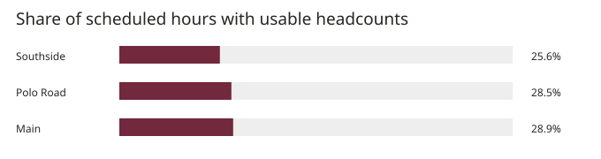

# Texas A&M rec center occupancy

How busy are the weight rooms at Main, Southside, and Polo Road?  
Author: [shawnslee1202](https://github.com/shawnslee1202)

## Daily collection summary

Updated November 10, 2026. The latest collection in the analysis was Nov 10 at 03:55 PM CST. The archive contains 71 successful collections and 2,336 distinct readings across 71 zones.

## Coverage through November 1, 2026



Usable headcounts covered about one quarter of scheduled weight-room hours through November 1, 2026.

## What this is

Texas A&M publishes the latest staff headcount for each recreation zone. This project saves the readings so visitors can compare occupancy by room, day, and hour. The analysis uses published opening hours and counts gaps separately so a missed reading cannot make a room look empty.

## Results at a glance

| Through November 1, 2026 | Finding |
|---|---|
| Count freshness | Half of the readings were at least [106 minutes old](docs/FINDINGS.md#count-freshness) when first collected. |
| Usable readings | [83 readings](docs/FINDINGS.md#opening-hours) passed the checks for analysis during verified opening hours. |
| Time covered | Usable readings covered [26% to 29% of scheduled hours](docs/FINDINGS.md#opening-hours) across the three weight rooms. |
| Crowding | The rooms spent [0 observed hours above 90% of capacity](docs/FINDINGS.md#crowding). Gaps leave the busiest room undetermined. |
| Forecasting | The [6-week evaluation minimum](docs/FINDINGS.md#forecasts) had not been reached in any room. |

[Dashboard](https://shawnslee1202.github.io/rec-occupancy/) · [Two-page report](reports/progress-report.pdf)

## Quick start

Use Python 3.12. Run these commands from the repository root. On Windows, activate the environment with `.venv\Scripts\Activate.ps1`.

```sh
python -m venv .venv
source .venv/bin/activate
python -m pip install -r requirements.txt
python -m unittest discover -s tests
```

## Reproduce

```sh
python -m rec_occupancy.analysis.analyze
python -m rec_occupancy.reporting.build_dashboard
python -m rec_occupancy.reporting.build_report
```

The commands use the included database, need no credentials, and take about a minute on a laptop after setup. Open [the dashboard file](dashboard/index.html) or [the report](reports/progress-report.pdf). The figures above describe the dated analysis, while the commands use the latest collected data.

## Repository map

| Directory or file | Contents |
|---|---|
| rec_occupancy/ | Python modules for collection, analysis, and reporting |
| raw/, rec_counts.sqlite | Original headcounts and the database used by the scheduled collector |
| config/, seeds/, sources/ | Operating hours, calendar dates, initial captures, and dated source records |
| sql/, tests/ | Cleaning rules and checks |
| notebooks/, figures/ | Analysis notebook and summary figure |
| dashboard/, reports/ | Dashboard, summary tables, and report |
| docs/ | [Methods](docs/METHODS.md), [findings](docs/FINDINGS.md), and [collection instructions](docs/DEPLOYMENT.md) |

## Limitations

- Staff record each room at different times, so comparisons can include older counts. [Count freshness](docs/FINDINGS.md#count-freshness)
- Scheduled collections can be hours apart, leaving parts of the day unobserved. [Coverage](docs/FINDINGS.md#opening-hours)
- Building hours can include periods when a particular room is closed. [Methods](docs/METHODS.md)
- Headcounts measure people present, so a change in arrivals cannot be measured directly. [Methods](docs/METHODS.md)

## Sources and attribution

Headcounts and hours come from [Texas A&M Rec Sports](https://recsports.tamu.edu/facilities/live-facility-count/) and its [published hours](https://recsports.tamu.edu/hours-of-operation/). Calendar dates come from the [Texas A&M academic calendar](https://registrar.tamu.edu/academic-calendar/index.html). Home games come from the [Texas A&M football schedule](https://12thman.com/sports/football/schedule/season/2026). Weather forecasts come from [Open-Meteo](https://open-meteo.com/) under [CC BY 4.0](https://creativecommons.org/licenses/by/4.0/).
